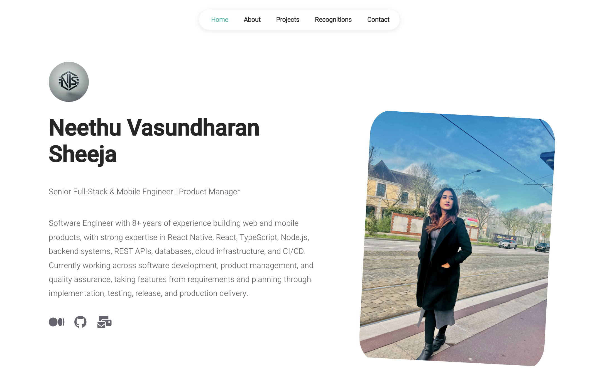

# Neethu Vasundharan Sheeja | Portfolio

****Senior Full-Stack & Mobile Engineer | Product Manager & Tech Lead****

Welcome to my personal portfolio! I'm a software engineer with **8+ years of experience** building web and mobile applications, specializing in React Native, full-stack development, technical leadership, and product delivery.

This portfolio showcases my professional experience, technical skills, selected projects, and achievements.

## 🌐 Portfolio Preview

<!-- Replace this path with the actual path of your portfolio screenshot -->


## ✨ Features

- Responsive personal portfolio
- Professional introduction and profile
- About and skills sections
- Selected software development projects
- Recognitions and achievements
- Contact and social links
- Multi-page navigation

## 🛠️ Tech Stack

**Frontend:** React.js, JavaScript, TypeScript, HTML5, CSS3

**Mobile Development:** React Native, Expo

**Backend:** Node.js, Express.js, REST APIs

**Databases:** PostgreSQL, MySQL, MongoDB, SQLite

**Cloud & Tools:** AWS, Git, GitHub, CI/CD, npm

## 🚀 Getting Started

### Prerequisites

Make sure you have Node.js, npm, and Git installed.

### Installation

Clone the repository:

```bash
git clone https://github.com/Nethzz/MyPortfolio.git
cd MyPortfolio
```

Install dependencies:

```bash
npm install
```

Start the development server:

```bash
npm start
```

Open [http://localhost:3000](http://localhost:3000) in your browser.

## 📁 Project Structure

```text
MyPortfolio/
├── public/          # Public assets and images
├── src/
│   ├── components/  # Reusable UI components
│   ├── data/        # Portfolio content and configuration
│   └── pages/       # Portfolio pages
├── package.json
└── README.md
```

## ⚙️ Customization

Portfolio content and configuration are maintained in the `src/data/` directory.

- `user.js` — Personal information and social links
- `articles.js` — Article content
- `seo.js` — Page metadata and SEO configuration
- `tracking.js` — Analytics configuration

Update these files to customize the content where applicable.

## 🏗️ Production Build

Create a production-ready build:

```bash
npm run build
```

The generated files will be available in the `build/` directory.

## 📬 Connect With Me

- **GitHub:** [Nethzz](https://github.com/Nethzz)
- **LinkedIn:** [Neethu Vasundharan](https://www.linkedin.com/in/neethu-vasundharan-225762150/)
- **Medium:** [My articles](https://neethuvasundharan.medium.com/)

## 📄 License

This project is based on the Reactfolio open-source portfolio template. Refer to the repository's `LICENSE` file for applicable license terms.
